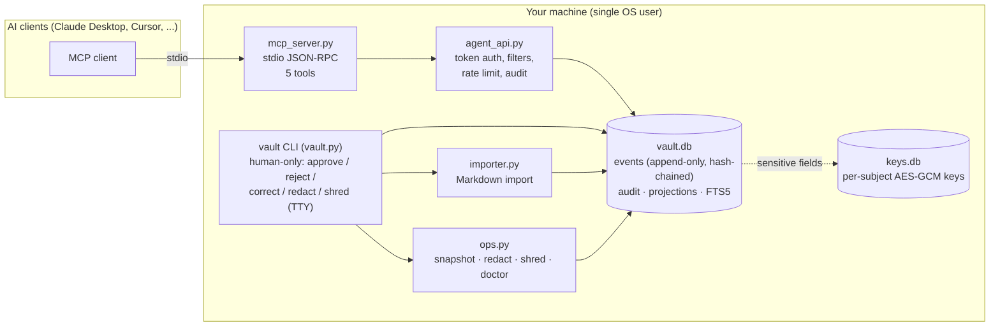

# Lattice Vault (prototype)

> [!WARNING]
> **Prototype — do not use in production.** This is an experimental, single-user, local-only research
> prototype. It has not been audited, its on-disk format will change, and several security controls are
> *detection only* or *planned*. See [SECURITY.md](SECURITY.md) before storing anything you care about.

Lattice Vault is a local, append-only memory vault for one person that several AI assistants can read
and *propose* additions to over the [Model Context Protocol](https://modelcontextprotocol.io) (MCP).
A human approves everything that becomes "verified".

## Why
Context about a person (preferences, decisions, projects, goals) gets scattered across chat tools and
AI assistants, and a shared Markdown folder is easy to overwrite by accident. The vault keeps:
- **one source of truth**: an append-only SQLite event log with full history, no UPDATE/DELETE;
- **human-in-the-loop**: agent writes are always `proposed` / `unverified` until a human approves them on the CLI;
- **portable context**: a budgeted, cited "Context Pack" that you can paste into any assistant;
- **local-first**: no server, no network code in the core.

## Architecture


- `events` is the only source of truth. Triggers forbid UPDATE/DELETE and restrict human-only event types
  (approve, reject, revert, redact, shred, batch approval) to `user:*` actors.
- Projections (`proj_*`) and full-text search are derived and rebuilt deterministically in `(hlc, id)` order.
- Corrections, reverts and approvals are new events, not edits.
- IDs are UUIDv7 and ordering uses a hybrid logical clock (HLC).

Design details: [docs/design.md](docs/design.md). Decisions: [docs/adr/](docs/adr/).

## Files
| File | Purpose |
|---|---|
| `vault.py` / `vault` | core library + CLI |
| `agent_api.py` | the only agent write path (token auth, validation, secret filter, rate limit, audit) |
| `mcp_server.py` | MCP stdio server (5 tools) |
| `importer.py` | Markdown import (dry run, batch approval, revert) |
| `ops.py` | snapshots, migrate, redact-to-new-file, crypto-shredding lifecycle, `doctor` |
| `crypto_keys.py` | per-subject AES-256-GCM key store (needs `cryptography`) |
| `citation_check.py` | human-CLI-only check for unsupported claims (not exposed over MCP) |
| `obs.py` | allowlisted JSON-lines ops log (file only, never stdout) |
| `examples/seed.py` | creates a synthetic demo vault |

## Install
Python 3.11+. The core uses only the standard library (SQLite with FTS5 and JSON1).
```sh
git clone <repo-url> lattice-vault && cd lattice-vault
python3 -m venv .venv && . .venv/bin/activate
pip install -r requirements.txt          # optional: cryptography, for encrypted fields / shredding
python -m unittest discover -p 'test_*.py'
python examples/seed.py ./demo-vault     # synthetic vault for a fictional user "Ada"
```

## CLI usage
Set `VAULT_DB` (default `./vault.db`). The human actor is `user:$VAULT_USER` (default `user:owner`).
Human-only commands require an interactive terminal.
```sh
export VAULT_DB=$HOME/.local/share/lattice-vault/vault.db

./vault add preference.set user:ada --key language --payload '{"value":"English"}'
./vault add decision.made decision:D-100 --payload '{"decision_id":"D-100","title":"Local-first","decision":"No cloud"}'
./vault add note.added user:ada --text 'bank note' --sensitive text   # encrypted field (per-subject key)
./vault search "local"
./vault pack --profile minimal           # Context Pack (minimal | full)
./vault pending                          # agent proposals waiting for review
./vault approve <event_id>               # or: reject <event_id> --reason ...
./vault correct <event_id> --field value --value "German" --reason "typo"   # append-only correction
./vault revert <event_id> --reason ...
./vault history user:ada

./vault import-markdown /path/to/notes --dry-run     # report only; nothing written
./vault import-markdown /path/to/notes               # one transaction, everything lands unverified
./vault import-approve <import_id> --owner-lines all # confirm owner-signed lines from the dry-run list
./vault revert-import <import_id>

./vault redact <event_id> --out redacted.db --reason ...   # copy-to-new-file; source left untouched
./vault shred user:ada --preview; ./vault shred user:ada --confirm --grace-days 7
./vault shred-cancel user:ada; ./vault shred-finalize user:ada
./vault doctor                           # triggers, hash chains, integrity_check, projection drift, keys, blocklist
./vault backup --out DIR                 # vault.db + manifest, never keys.db (docs/backup-restore.md)
./vault backup-keys --out DIR2           # keys.db only (wrapped); keep apart from vault backups
./vault restore DIR --to PATH [--keys DIR2] [--force]  # verified restore drill
./vault migrate old.db new.db            # schema migration by copy
```
Run `./vault -h` and `./vault <command> -h` for all options.

## MCP usage
Tools (exactly 5): `get_summary`, `search`, `export_context_pack`, `get_event`, `propose_event`.
Resources: `vault://pack/{profile}`, `vault://event/{id}`, `vault://summary`. Protocol versions:
`2025-06-18` (preferred), `2025-03-26`, `2024-11-05`. There is no approve tool over MCP.

1. Register an agent; the token is printed **once** (only its SHA-256 hash is stored in `agents.json`, mode 0600):
   ```sh
   ./vault agent-add my-assistant
   ```
2. Save the token to a file only you can read (preferred over putting it in the client config):
   ```sh
   umask 077; printf '%s' '<TOKEN>' > ~/.config/lattice-vault/my-assistant.token
   ```
3. Configure the client.

**Claude Desktop** (`claude_desktop_config.json`):
```json
{
  "mcpServers": {
    "lattice-vault": {
      "command": "python3",
      "args": ["/path/to/lattice-vault/mcp_server.py"],
      "env": {
        "VAULT_DB": "/path/to/vault.db",
        "VAULT_AGENT_TOKEN_FILE": "/path/to/my-assistant.token"
      }
    }
  }
}
```
**Cursor** (`.cursor/mcp.json` or `~/.cursor/mcp.json`):
```json
{
  "mcpServers": {
    "lattice-vault": {
      "command": "python3",
      "args": ["/path/to/lattice-vault/mcp_server.py"],
      "env": { "VAULT_DB": "/path/to/vault.db", "VAULT_AGENT_TOKEN_FILE": "/path/to/other-assistant.token" }
    }
  }
}
```
Use one agent (and one token) per client. `VAULT_AGENT_TOKEN` (the token itself in the env) also works but
is discouraged: client config files are often synced or shared, and environment variables are readable
via `/proc/<pid>/environ` by the same OS user. Never commit MCP client configs.

## Configuration
| Variable | Meaning |
|---|---|
| `VAULT_DB` | database path (default `./vault.db`) |
| `VAULT_USER` | local human actor name → `user:<name>` (default `owner`) |
| `VAULT_OWNER_NAME` | signature name treated as the owner during Markdown import (default `owner`) |
| `VAULT_AGENTS` | agent registry path (default `agents.json` next to the DB) |
| `VAULT_AGENT_TOKEN_FILE` / `VAULT_AGENT_TOKEN` | agent token for `mcp_server.py` / `vault propose` |
| `VAULT_KEYS_DB`, `VAULT_KEK_FILE`, `VAULT_PASSPHRASE` | key store, key-encryption key file, or passphrase (scrypt) |
| `VAULT_SHRED_GRACE_DAYS` | default shred grace period |
| `VAULT_LOG` | ops log path (JSON lines) |
| `VAULT_OFFLINE`, `VAULT_HTTP_TIMEOUT`, `VAULT_REVIEW_SAMPLE_PCT`, `VAULT_ROOT` | citation check |
| `VAULT_ALLOW_NONTTY` | **tests only**: bypasses the TTY gate for human commands |

## Status and limits
Implemented vs planned is tracked per decision in [docs/adr/](docs/adr/). Not built: multi-device sync,
signed events/approvals, external integrity anchor, OS-keychain key storage. Known limits are in
[SECURITY.md](SECURITY.md). Changes: [CHANGELOG.md](CHANGELOG.md).

## Türkçe özet
Lattice Vault, tek kullanıcılı, yerel, yalnız-ekleme (append-only) bir hafıza kasası prototipidir. AI
asistanlar MCP üzerinden okur ve yalnız *öneri* yazar; doğrulanmış içerik yalnız insan onayıyla oluşur.
Arama Türkçe karakter katlamalıdır (`ı/i`, `ş/s` …). **Prototiptir; üretimde kullanmayın.**

## License
Apache-2.0 — see [LICENSE](LICENSE) and [NOTICE](NOTICE).

---

<sub>Lattice Labs · Created by Kerem Talha Oral · Licensed under Apache-2.0</sub>
